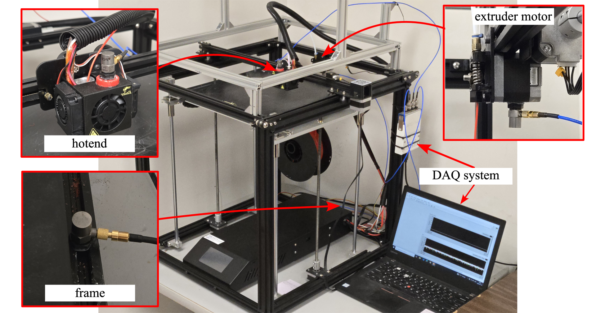
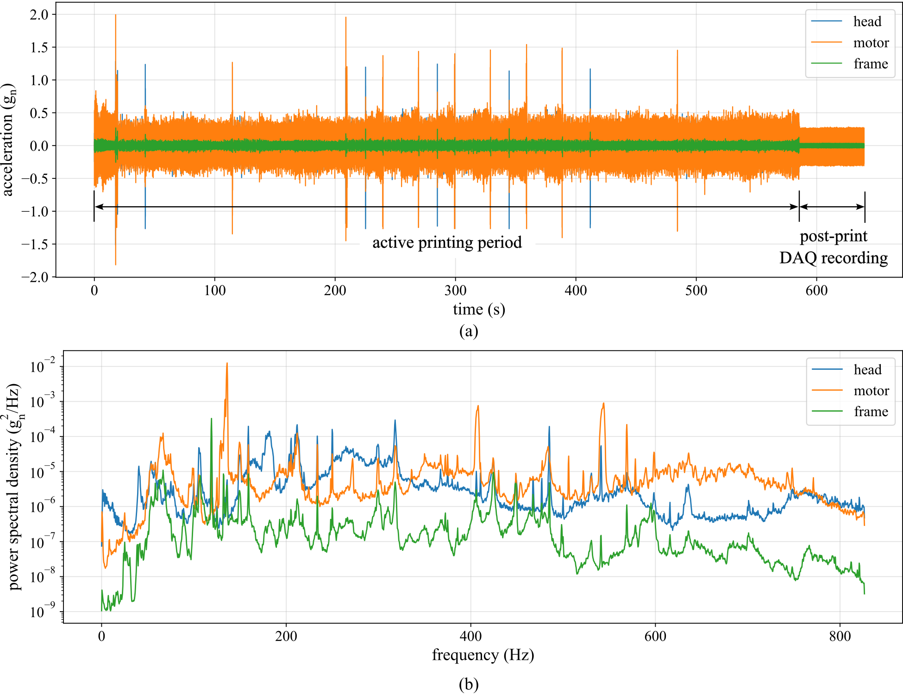

# A 1,600-Hour FFF Printer Vibration Dataset with Three-Point Sensing and Periodic Tensile-to-Failure Testing

This repository holds a long-term, multi-sensor dataset acquired from a single Creality Ender 5 Plus fused filament fabrication (FFF) printer operated for approximately 1,600 hours over roughly 1.5 years. Three accelerometers on the extrusion head, filament-feeding motor, and printer frame recorded vibration at approximately 1,651.6 samples/s across 15 wear states from 179 to 1,537 cumulative operating hours. At each state, five PLA dogbone specimens were printed under fixed process parameters and tensile-tested to failure, providing paired machine-condition and part-performance records at each sampled state.

This publicly available dataset pairs FFF vibration measurements with tensile-test records collected over extended printer operation. It supports condition-based maintenance, wear-progression modeling, transfer learning between short- and long-horizon vibration data, and physics-informed models linking printer health to part strength.

*Figure 1. Experimental setup: accelerometer placement on the extrusion head (hotend), feeding motor, and printer frame, together with the NI 9234 data-acquisition chain.*

*Figure 2. Representative vibration response at wear state 13: (a) time-domain acceleration signals from the extrusion head, motor, and frame sensors at 1,405 cumulative printing hours and (b) corresponding PSD estimated using Welch's method.*

## Repository structure

| Folder | Content | Format | Files |
|---|---|---|---|
| `raw_vibration/` | Raw vibration recordings from the three accelerometers (head, motor, frame), one recording per wear state | `.lvm` | 15 |
| `tensile/` | Force–crosshead-displacement–time records from the MTS Exceed E43, five specimens per wear state | `.txt` | 75 |
| `features/` | Extracted 81-feature table and its wear-state-1-normalized version | `.csv` | 2 |
| `maintenance_log/` | Chronological record of maintenance events, process-parameter changes, and excluded intervals | `.csv` | 1 |
| `script/` | Python scripts for vibration feature extraction and normalized feature-trace plots | `.py` | 2 |

## Vibration data (`raw_vibration/`)

Signals were acquired at approximately 1,651.6 samples per second with three PCB Piezotronics Model 352A92 ICP accelerometers, an NI 9234 IEPE module, and an NI cDAQ-9171 chassis, and stored in LabVIEW Measurement (`.lvm`) format. Each file has four columns: a time stamp and three acceleration channels in the order head, motor, frame, in units of *g* (1 *g* = 9.80665 m/s²). Complete recordings cover approximately 639.4 s, including a post-print interval of approximately 50–67 s. The released feature tables use the signals after excluding the first 33,032 recorded samples (approximately 20 s) to reduce initial transients; recordings at wear states 9 and 14 have missing initial samples.

Files are named `Sample01.lvm` through `Sample11.lvm` (states 1–11) and `Sample_12.lvm` through `Sample_15.lvm` (states 12–15). Cumulative operating hours per state (179–1,537 h) are listed in `features/features.csv` and the maintenance log.

## Tensile data (`tensile/`)

At each wear state, five PLA dogbone specimens (modified ASTM D638 Type IV geometry) were printed under identical conditions and pulled to failure on an MTS Exceed E43 load frame at approximately 50 mm/min, with force and crosshead displacement sampled at 10 Hz. Each `.txt` file contains crosshead displacement (mm), load (N), and time (s). Files follow `wearstate-replicate.txt` (for example, `7-3.txt` is specimen 3 at wear state 7).

Peak tensile force and crosshead displacement at peak can be calculated from the released test records. Crosshead displacement is not a direct measurement of specimen gauge-section elongation.

## Feature tables (`features/`)

`features.csv` contains 81 features per wear state — 27 per sensor across three categories:

- **Statistical (11):** mean, standard deviation, variance, minimum, maximum, range, median, interquartile range, mean absolute deviation, skewness, excess kurtosis.
- **Time-series / signal-shape (8):** RMS, peak, peak-to-peak, absolute mean, crest factor, shape factor, impulse factor, clearance factor.
- **Frequency-domain (8):** peak frequency, peak amplitude, spectral centroid, spectral spread, spectral skewness, spectral kurtosis, band power 0–100 Hz, band power 100–500 Hz. The two band-power features are sums of FFT amplitudes, not PSD-integrated powers.

`features_normalized.csv` holds the same features divided by their wear-state-1 value. Columns are named `{sensor}_{feature}` with `{sensor} ∈ {Head, Motor, Frame}`; the tables also contain wear-state indices and cumulative operating hours, but not mean peak tensile force. Wear state 1 (179 h) is the earliest recorded reference, not a new-machine baseline. Columns whose wear-state-1 value is zero yield `NaN` in the normalized file and should be read from `features.csv`.

## Process-parameter change between samples 11 and 12

Between roughly 851 and 1,248 cumulative hours the printer ran a 0.6 mm nozzle rather than the 0.4 mm nozzle used for the rest of the study. Because nozzle diameter changes the vibration signature, that interval is excluded to keep a single process configuration; the curated dataset documents only 0.4 mm operation. Sample 12 (1,334 h) is the first recording after reverting to 0.4 mm, which is why cumulative time jumps between samples 11 and 12. `maintenance_log/maintenance_log.csv` is the authoritative event timeline (nine columns: event ID, ISO 8601 date, cumulative hours, event type, original session index 1–23, curated wear-state index 1–15, active nozzle diameter, included flag, and description).

## Scripts (`script/`)

- `extract_features.py` — provides routines to calculate the 81 vibration features and write feature tables; its configured input paths and wear-state mapping must be adjusted to the files in this repository before use.
- `plot_features.py` — generates the nine normalized feature-trace figures from `features_normalized.csv` (set the input path as needed).

## Citation

If you use this dataset, please cite the accompanying Data in Brief article (Fu et al., 2026) and this repository: https://doi.org/10.5281/zenodo.21795890

## License

[![CC BY-SA 4.0][cc-by-sa-shield]][cc-by-sa]

This work is licensed under a
[Creative Commons Attribution-ShareAlike 4.0 International License][cc-by-sa].

[cc-by-sa]: http://creativecommons.org/licenses/by-sa/4.0/
[cc-by-sa-image]: https://licensebuttons.net/l/by-sa/4.0/88x31.png
[cc-by-sa-shield]: https://img.shields.io/badge/License-CC%20BY--SA%204.0-lightgrey.svg

## Acknowledgments

Collected at the ARTS Laboratory, Department of Mechanical Engineering, University of South Carolina, Columbia, SC.
